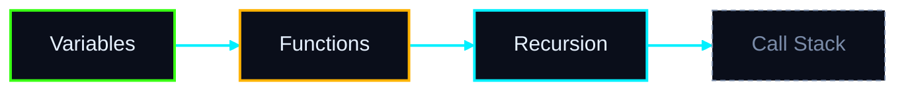

# CODE ATLAS — Universal Programming Language Learning & Knowledge Centre
Module specification for CODEMIND (v2)

## 0. HOW TO USE THIS SPEC (READ FIRST)

You are building CODE ATLAS as an integrated module of CODEMIND, not a standalone documentation site.

### Working rules
1. Build in the phases in Section 17. Finish and verify one phase before starting the next.
2. Build one complete vertical slice first (Python). Only after it passes the Definition of Done do you add other languages through the same content-package system.
3. Never invent syntax, library behaviour, version facts or documentation URLs. If a fact cannot be verified, mark it `status: unverified` and exclude it from learner-facing views.
4. Never state or imply "complete language coverage". Show a live coverage meter per language (topics written, examples verified, topics reviewed).
5. Before each phase, state in 5 lines or fewer: what you will build, what you will stub, and what is not feasible yet. Do not overpromise.
6. Do not copy official documentation verbatim. Write original explanations and link to the official source (see Section 14).

### Non-goals (v1)
Full language-spec reproduction, native mobile apps, user-generated public content, running arbitrary long-lived programs, GUI/OS-level programs in the playground.

---

## 1. PRODUCT PRINCIPLES

- **Teach the language, not just analyse programs.** Every uploaded-code insight can deep-link to a lesson, and every lesson can deep-link to a trace.
- **Honest differences.** Python, C, C++, Java, JavaScript, TypeScript, Go, Rust, SQL and C# differ in execution model, memory model, typing, and paradigm. SQL is declarative and set-based; do not force it into loop/function templates. Each language hub adapts its topic list.
- **Verified over plausible.** Every code example is executed in CI; its recorded output must match the displayed output.
- **Adaptive.** Content adjusts to level, goal, time, and demonstrated mastery.
- **Accessible and fast.** Works on a phone and low bandwidth; keyboard-navigable; screen-reader friendly.

---

## 2. SUPPORTED LANGUAGES AND TIERS

Launch languages: Python, C, C++, Java, JavaScript, TypeScript, Go, Rust, SQL, C#.

Each language declares a capability tier in its package manifest, so the UI is honest about what works:

| Capability | Meaning |
| :--- | :--- |
| **Tier A** | Lessons + runnable playground + Trace Studio step-through |
| **Tier B** | Lessons + runnable playground, no step trace (or limited trace) |
| **Tier C** | Lessons + read-only examples with recorded outputs |

State a realistic starting tier per language in your phase-1 plan (e.g., Python and JavaScript likely Tier A first; compiled languages usually need a sandboxed compiler service). Do not claim a tier you have not tested.

Language packages are modular and pluggable: adding a language = adding a content package + execution adapter + trace adapter, with zero changes to core application code.

---

## 3. CONTENT ARCHITECTURE (SINGLE SOURCE OF TRUTH)

Content lives in versioned files (Markdown + YAML/JSON frontmatter), validated by a schema in CI. Suggested layout:

```text
/content/<language>/
  manifest.json              # language, versions supported, tier, doc base URLs, maintainers
  /topics/<topic-id>.md      # lessons
  /syntax/<construct-id>.json
  /mistakes/<mistake-id>.json
  /patterns/<pattern-id>.json
  /exercises/<exercise-id>.json
  /quizzes/<quiz-id>.json
/content/_shared/concepts/<concept-id>.json   # language-neutral concept graph nodes
```

### 3.1 Required metadata on every content item
`id`, `language`, `language_version_min`, `language_version_max` (or `current`), `topic`, `level` (beginner/intermediate/advanced), `prerequisites[]`, `related_concepts[]`, `doc_references[]` (with `source_type`), `deprecation_status` (`current` | `deprecated` | `removed` | `experimental`), `review_status` (`draft` | `verified` | `reviewed`), `last_verified_date`, `verified_with_toolchain_version`.

### 3.2 Syntax construct schema
`name`, `official_syntax` (grammar-style notation where the official docs provide it), `explanation_simple`, `explanation_technical`, `components_or_parameters[]`, `example` (code), `expected_output`, `output_is_deterministic` (bool), `common_mistakes[]` (links), `related_concepts[]`, `version_compatibility`, `use_cases[]`, `doc_references[]`, `deprecation_status`.

### 3.3 Reference source types (always label them in the UI)
- Official specification (e.g., language standard / spec)
- Official standard-library or API documentation
- Educational explanation (original content written for CODE ATLAS)
- AI-generated answer (grounded, with citations; see Section 9)

---

## 4. LANGUAGE HUB STRUCTURE

Each hub contains:
- **A. Overview** (history, paradigm, typing, execution model, memory model, where it is used, strengths and limits)
- **B. Installation and environment setup** (per OS; versions; common setup failures)
- **C. Syntax reference**
- **D. Core concepts**
- **E. Advanced concepts**
- **F. Standard libraries and important APIs** (curated, not exhaustive, labelled as such)
- **G. Practical programming examples**
- **H. Common mistakes**
- **I. Best practices** (with rationale, and style-guide source where one exists)
- **J. Learning roadmap**
- **K. Exercises and quizzes**
- **L. Interview and competitive-programming preparation** (I/O templates, common idioms, pitfalls such as integer overflow in C++/Java, recursion limits in Python)
- **M. Ecosystem:** package managers, build tools, test frameworks, linters/formatters, debugging tools
- **N. Tooling and debugging:** debugger basics, reading error messages and stack traces, profiling basics
- **O. Glossary and cheat sheet** (printable)
- **P. Version and deprecation timeline** (what changed, what to avoid)

Language-specific notes the content must respect (examples, not exhaustive):
- **C/C++:** manual memory, undefined behaviour, pointers, headers/compilation model, RAII (C++), standard versions.
- **Java / C#:** managed runtimes, garbage collection, classes everywhere, generics with differing implementations.
- **Python / JavaScript:** dynamic typing, duck typing, event loop (JS), GIL (CPython), mutability and reference semantics.
- **TypeScript:** types erased at runtime, structural typing, relationship to JavaScript.
- **Go:** goroutines/channels, interfaces, no inheritance, explicit errors.
- **Rust:** ownership, borrowing, lifetimes, traits, `Result` / `Option`, no GC.
- **SQL:** declarative, set-based, dialect differences (state which dialect each example targets), NULL three-valued logic, query execution order versus written order.

---

## 5. LESSON SYSTEM

Level groups (adapt per language; drop or add topics honestly):
- **Beginner:** syntax, variables, types, operators, I/O, conditions, loops, functions.
- **Intermediate:** collections, strings, recursion, files, exceptions/errors, modules/packages, OOP or the language's equivalent (Go structs/interfaces, Rust traits, SQL joins/subqueries).
- **Advanced:** memory, concurrency, async, generics, advanced data structures, design patterns, performance, testing, language-specific features (decorators, templates, ownership, LINQ, window functions...).

### 5.1 Lesson template
1. Learning objectives (measurable: "You can write X", "You can predict the output of Y")
2. Prerequisites check (3-question quick diagnostic; links to missing prerequisites)
3. Simple explanation (analogy-based, plain language)
4. Technical explanation (precise, with correct terminology)
5. Syntax
6. Worked examples (from trivial to realistic)
7. Output and line-by-line walkthrough
8. Visual demonstration (memory diagram, call stack, loop trace) where it helps
9. "Predict the output" mini-challenges before showing results
10. Common mistakes (linked to the mistake library)
11. Practice questions (graded difficulty)
12. Knowledge assessment (quiz)
13. Summary, "what to learn next", and Open in Trace Studio button

### 5.2 Learner support
- Level toggle: Simple / Standard / Deep explanations on the same page.
- Reading-time estimates and progress indicator.
- Bookmarks, personal notes, and highlights.
- "I'm stuck" button: sends the lesson context to the AI Tutor.

---

## 6. INTERACTIVE PLAYGROUND AND EXECUTION

### 6.1 Features
Editor with syntax highlighting, run, reset, share-link, edit-the-example, input (stdin) panel, output and error panels, side-by-side output comparison (original vs modified), "explain this error" (AI Tutor), "Open in Trace Studio", save snippets to the learner's workspace.

### 6.2 Execution safety (mandatory)
Run code only in an isolated sandbox: no network by default, no host filesystem access, CPU/memory/time/output limits, process-count limits, per-user rate limits, and automatic cleanup. Choose an approach per language (browser-side WebAssembly runtimes or a server-side sandbox such as container/microVM-based execution) and record the decision with its trade-offs. Treat all submitted code as hostile. Add abuse tests (fork bombs, infinite loops, huge output, file/network access attempts) to the test suite.

### 6.3 Honesty about limits
Where a language cannot be executed (or only partially), show that clearly, with the recorded output labelled "Pre-recorded output".

### 6.4 Trace Studio bridge
Define a language-neutral trace event schema (line executed, variable assignment, function call/return, loop iteration, heap/stack snapshot where available) that each language's trace adapter emits. Lesson examples carry a `trace_ready` flag. Opening a lesson example in Trace Studio passes code, language, version, stdin, and the concept tag (e.g., `nested-loops`) so Trace Studio can open the matching visualization preset.

---

## 7. LANGUAGE COMPARISON ENGINE

- Compare any concept across 2 to 4 languages side by side: variables, types, conditionals, loops, functions, classes, inheritance, interfaces/traits, errors/exceptions, collections, strings, null handling, memory management, concurrency, modules, generics.
- Every comparison entry has four fields: Syntax, Semantics, Gotchas, Runnable example with verified output.
- Include a "Looks the same, behaves differently" section as a first-class feature. Examples: integer division and overflow, `==` versus equality semantics, pass-by-value versus reference, string immutability, default argument evaluation, truthiness, array/slice semantics, closure capture in loops.
- Translate-a-snippet mode: paste code in language A, see idiomatic equivalent in language B with a list of semantic differences; label output as AI-assisted and verify by running both versions where possible.

---

## 8. ROADMAP GENERATOR

### 8.1 Inputs
Language, current experience (self-report plus a short adaptive diagnostic), goal, weekly time budget, target date (optional), concepts already mastered (from Learning DNA).

### 8.2 Goals supported
Learn from scratch; university exam preparation (user supplies syllabus or topic list, and the roadmap maps to it); data structures and algorithms; coding interviews; backend development; data/analytics (esp. SQL, Python); systems programming (C, C++, Rust); web development (JavaScript, TypeScript); build a practical project; switch from another language (uses the comparison engine).

### 8.3 Output
- Prerequisite DAG with node states: locked / available / in progress / mastered.
- Week-by-week plan fitted to the time budget, with milestones and a checkpoint project.
- Re-planning when the learner falls behind or tests out of topics.
- Estimates shown as ranges with assumptions, never promises.
- Export as PDF or calendar entries.

---

## 9. DOCUMENTATION INTELLIGENCE (SEARCH AND Q&A)

### 9.1 Search
Hybrid retrieval: keyword (BM25) plus semantic embeddings, with filters for language, version, level, and content type. Support typo tolerance, synonyms ("pointer" / "reference" / "address"), and cross-language queries ("Python decorators in JavaScript").

### 9.2 Grounded Q&A (RAG)
- Answers are generated only from retrieved CODE ATLAS content and linked official docs.
- Each answer shows citations, labelled by source type (Section 3.3).
- If retrieval confidence is low, say so and show the closest lessons instead of guessing.
- Answers respect the learner's selected language and version.
- Supports the example questions: pointers, Java HashMap internals, Python decorators, list vs tuple, C memory allocation, async JavaScript, Rust ownership.
- Every answer offers: Explain simpler, Explain deeper, Show example, Open in playground, Quiz me.

### 9.3 Evaluation
Maintain a golden question set (at least 20 per language at launch) with expected source lessons; track retrieval hit rate and flag answers that cite nothing.

---

## 10. COMMON MISTAKES AND DEBUGGING LIBRARY

- Per mistake: incorrect code, actual error or wrong behaviour (captured by running it), why it happens, corrected code, expected behaviour, related concept, severity (syntax / semantic / runtime / conceptual misconception), and a "how to spot it" tip.
- Add a **Misconception Detector**: given a learner's wrong quiz answer, map it to a likely misconception and show a targeted mini-lesson.
- Add an **Error Message Decoder**: paste a compiler/runtime error, get a plain-language explanation, the likely cause, and a link to the lesson. Error text must come from the real toolchain version noted in the metadata.

---

## 11. CODE PATTERN LIBRARY

- Patterns: counter, accumulator, nested loops, searching, sorting, two pointers, sliding window, prefix sums, recursion, divide and conquer, backtracking, dynamic programming, greedy, graph traversal (BFS/DFS), shortest paths, tree traversal, union-find, heap/priority-queue usage, bit manipulation, plus object-oriented design patterns (and their language-appropriate equivalents, e.g., closures and functions as replacement for some patterns in Python/JS).
- Per pattern: problem it solves, when to recognize it (signal phrases in problem statements), conceptual explanation, implementations in each supported language, visual execution via Trace Studio, time and space complexity with justification, variants, common pitfalls, exercises, and links to LeetCode Lab problems.

---

## 12. CONCEPT KNOWLEDGE GRAPH

- **Nodes:** concepts (language-neutral) with language-specific realizations (e.g., "Function" realizes differently in Python, C, Rust).
- **Edge types:** `prerequisite`, `part-of`, `related`, `contrasts-with`, `commonly-confused-with`, `leads-to`.
- **Selecting a node shows:** explanation, prerequisites, related concepts, example code, lessons, practice exercises, mastery state from Learning DNA.
- **Views:** whole graph, local neighbourhood, per-language filter, "my gaps" (unmastered prerequisites highlighted).
- Provide an accessible list/tree fallback for the graph, since graph visuals are hard on small screens and for screen readers.

---

## 13. ASSESSMENT AND ADAPTIVE LEARNING

- **Question types:** multiple choice, predict-the-output, fix-the-bug, fill-in-the-blank, reorder-lines (Parsons problems), short code-writing with automated tests, concept matching.
- Every question tags the concepts and misconceptions it tests.
- Adaptive difficulty and spaced-repetition review queue for concepts the learner is forgetting.
- Hints in levels (nudge → partial → solution), with hint usage recorded.
- Code-writing exercises run hidden tests in the sandbox and report which cases failed, without revealing the test data in full.
- Understanding Proof Engine hook: after a lesson, ask the learner to explain a concept or predict a trace and score understanding, not just correctness.

---

## 14. CONTENT QUALITY, VERSIONING, LICENSING

- Content is written from official sources and verified against actual toolchains.
- **Licensing:** record each source's licence. Do not copy documentation text beyond what its licence allows; write original explanations and link to the official page. Never reproduce copyrighted textbooks.
- **Version handling:** every item has min/max version; the UI has a version selector; version-dependent behaviour is visibly badged (e.g., "Python 3.10+", "C++20", "Java 17+"); deprecated and removed features carry warnings and the recommended replacement.
- **CI validation pipeline (blocks merges):**
  1. Schema validation of all content files.
  2. Every example is executed on the declared toolchain; output must match `expected_output` (non-deterministic examples are flagged and tested with property checks).
  3. Link checker for documentation references.
  4. Broken-prerequisite and orphan-concept checks in the graph.
  5. Lint for unverified or draft items appearing in learner-facing views.
- **Review workflow:** `draft` → `verified` (automated) → `reviewed` (human). Only `verified` or `reviewed` content is shown by default.
- **Content update path:** content packages update independently of the app; show "last verified" dates; support a learner "Report an error" button feeding a review queue.
- Do not display "complete" for any language until coverage and review targets (Section 16) are met.

---

## 15. INTEGRATION WITH CODEMIND MODULES

Define a shared learning-context object passed between modules:
```typescript
{
  user_id: string;
  language: string;
  version: string;
  current_lesson_id: string;
  current_concept_ids: string[];
  recent_errors: string[];
  quiz_results: any[];
  mastery_snapshot: any;
  trace_session_id?: string;
}
```

| Module | Integration |
| :--- | :--- |
| **AI Tutor** | Receives the current lesson, selected text, learner level, and mistakes; answers within the lesson's scope with citations |
| **Trace Studio** | "Open in Trace Studio" with code and concept preset; return link back to the lesson |
| **Deep Code Intelligence** | Detects constructs in uploaded code, maps them to syntax entries and lessons ("This code uses a list comprehension → lesson") |
| **LeetCode Lab** | Pattern library links to problems; problem hints link to patterns and lessons |
| **Logic Detective** | Common-mistake library supplies hypotheses for bugs |
| **What-If Laboratory** | Lesson examples can be mutated ("what if I change this condition?") |
| **Concept Universe** | Shares the knowledge graph (single graph, no duplicate) |
| **Understanding Proof Engine** | Uses lesson concepts for explain-back and prediction tasks |
| **Learning DNA** | Receives mastery events (below); supplies mastery snapshot for roadmaps and recommendations |

### 15.1 Learning DNA event schema
Emit events: `lesson_started`, `lesson_completed`, `quiz_answered` (with concept tags, correctness, time, hints used, misconception id), `exercise_submitted`, `playground_run` (error type), `trace_opened`, `search_performed`, `roadmap_progress`. Define concept-mastery update rules (for example, a simple evidence-weighted model) and document them.

### 15.2 Recommendation behaviours
- Unfamiliar construct in uploaded code → link to the lesson.
- Repeated failure on a topic → recommend prerequisites, show the diagnostic gap.
- Lesson completed → suggest a Trace Studio practice, then spaced-repetition review.
- Strong mastery → suggest skipping ahead.

**Privacy:** learners can view, export, and delete their learning data.

---

## 16. DEFINITION OF DONE (MEASURABLE)

Per language, to be labelled "Launch-ready":
1. Hub contains sections A to P, with the coverage meter visible.
2. Minimum content (set realistic targets in the phase-1 plan): beginner track complete, intermediate track substantially complete, advanced topics listed with at least a defined subset written.
3. 100% of displayed examples pass CI execution verification (or are explicitly labelled pre-recorded).
4. Every lesson has at least one quiz and one exercise, all tagged with concepts.
5. All content has doc references, version ranges, and review status.
6. Golden-question retrieval hit rate meets the target you set (suggest 85% or higher).
7. Search returns relevant results for the Section 9 example questions.
8. Playground and Trace Studio work as per the language's declared tier.
9. Comparison entries exist for at least 10 concepts involving this language.
10. Progress events reach Learning DNA and roadmaps use mastery data.
11. Accessibility checks pass (keyboard navigation, contrast, screen-reader labels).
12. Security tests for the sandbox pass.

App-level:
- Adding a new language package works without modifying core code (prove it by adding a small test language).
- Page load, search latency, and playground start-time budgets are defined and measured.

---

## 17. DELIVERY PHASES

### Phase 1: Foundations and Python vertical slice
Content schema and validators, CI example runner, hub shell, syntax library UI, lesson renderer, Python beginner track, sandbox execution for Python, search v1, basic quizzes, Learning DNA events, coverage meter.

### Phase 2: Intelligence and integration
Trace Studio bridge for Python, RAG Q&A with citations, AI Tutor lesson-awareness, mistake library and error decoder, roadmap generator v1, knowledge graph v1.

### Phase 3: Breadth
JavaScript and TypeScript, SQL, Java, C, C++, Go, Rust, C#, each through the package system; comparison engine; pattern library with multi-language implementations.

### Phase 4: Depth and polish
Adaptive assessment and spaced repetition, advanced tracks, interview/competitive prep, translate-a-snippet, accessibility and performance tuning, content review at scale.

At the end of each phase, report: what works, what is stubbed, what is not feasible, known risks, and the next phase's plan.

---

## 18. ADDITIONAL FEATURES (OPTIONAL, PRIORITIZE AFTER CORE)

- Daily practice: one short challenge or review per day with streaks (avoid manipulative mechanics).
- Project-based tracks: guided mini-projects per language (CLI tool, REST API, data analysis script) with checkpoints.
- Code reading mode: annotated real-world code samples to build reading skill.
- Refactoring lab: before/after improvements with the rule explained.
- Performance playground: compare two implementations' complexity or timing (with caveats about benchmark reliability).
- Memory visualizer: stack/heap, pointers, references, ownership moves (C, C++, Rust, Java, Python object model).
- Exam mode: timed paper-style practice for university syllabi.
- Offline-capable lessons (cached content, read-only examples).
- Multilingual UI (start with the content architecture ready for translation).
- Instructor mode: classroom assignments, class progress dashboard (later phase).
- Cheat-sheet and flashcard export.
- Community error reports feeding the review queue.

---

## 19. TECHNICAL REQUIREMENTS

- Modular architecture; content separated from code; typed interfaces for language packages, execution adapters, and trace adapters.
- Documented decisions (short ADRs) for: sandbox choice, search/RAG stack, graph storage, state management.
- Test coverage for content validators, search relevance, sandbox limits, and the module integration contracts.
- Logging and error monitoring with no sensitive learner code retained beyond user-controlled retention.
- Everything configurable through content packages and config files, not hard-coded per language.

---

## 20. NEON MERMAID VISUAL SYSTEM ("ATLAS GLOW")

CODE ATLAS uses Mermaid diagrams everywhere a concept, flow or relationship is explained, styled in a consistent neon-on-dark cyber aesthetic.

### 20.1 Where Mermaid is used

| Area | Diagram type |
| :--- | :--- |
| Language hub overview / execution model | flowchart (source → compile/interpret → run) |
| Roadmaps and prerequisites | flowchart with node states (locked / available / in progress / mastered) |
| Concept map (small neighbourhoods) | flowchart or mindmap |
| Recursion, call stack, request lifecycle | sequenceDiagram |
| OOP: classes, inheritance, traits/interfaces | classDiagram |
| Object lifecycle, state machines (async, threads, ownership moves) | stateDiagram-v2 |
| SQL schemas and joins | erDiagram |
| Learning timelines, version history | timeline |
| Algorithm flow, loops, conditions | flowchart |

**Honest scoping:** Mermaid is best for small to medium diagrams. The full interactive knowledge graph (hundreds of nodes, zoom, filter, click-to-explore) must use a graph library (e.g., Cytoscape.js or D3), styled with the same neon design tokens. Do not force large graphs into Mermaid.

### 20.2 Design tokens (single source, shared with the whole UI)

```css
--bg: #0a0e1a
--panel: #10162b
--neon-cyan: #00f0ff
--neon-magenta: #ff2bd6
--neon-green: #39ff14
--neon-violet: #9d4dff
--neon-amber: #ffb300
--neon-red: #ff3860
--text: #e6f1ff
--muted: #7a8ba8
```

Semantic colours: concept = cyan, prerequisite = violet, mastered = green, in-progress = amber, error/mistake = red, advanced/special = magenta.

### 20.3 Mermaid theme configuration

Initialize Mermaid once with `theme: "base"` and `themeVariables` mapped from the tokens (background, primaryColor, primaryTextColor, primaryBorderColor, lineColor, secondaryColor, tertiaryColor, fontFamily set to a monospace/tech font such as JetBrains Mono or Fira Code with fallbacks). Use `classDef` for semantic node classes, for example:



### 20.4 Glow and animation (applied outside Mermaid)

Mermaid itself does not do glow. Apply effects to the rendered SVG with CSS:
- Glow via `filter: drop-shadow(0 0 6px <colour>)` on node borders and edges, with a subtle stronger glow on hover and selection.
- Animated "data flow" along edges with `stroke-dasharray` plus `stroke-dashoffset` animation.
- Optional faint grid or scanline background on diagram panels.
- Respect `prefers-reduced-motion`: disable animations. Provide a glow intensity setting and a light-mode / high-contrast fallback.
- Keep glow cheap: limit filter effects on diagrams with many nodes (set a node-count threshold above which glow reduces to borders only).

### 20.5 Interactivity
- Click a node to open its lesson, syntax entry or concept panel (Mermaid click callbacks or post-render SVG event binding; if using callbacks, configure Mermaid's security level deliberately, never disable protections blindly).
- Hover tooltips with a one-line definition.
- Zoom and pan container, fullscreen mode, copy Mermaid source, export PNG / SVG.
- "Step through" mode for sequence and flow diagrams: highlight one node or message at a time, synced with the Trace Studio step and the lesson text.

### 20.6 AI-generated diagrams
The AI Tutor may generate Mermaid on demand ("draw how recursion works"). Rules:
1. Validate syntax with the Mermaid parser before rendering; on failure, retry once with the parse error, then fall back to a text explanation.
2. Treat generated Mermaid as untrusted input: sanitize labels, no raw HTML in labels, strict security level.
3. Automatically apply the neon theme and semantic classes; the AI must not hard-code its own colours.
4. Keep diagrams small (suggest max ~25 nodes); split larger ideas into linked diagrams.

### 20.7 Accessibility and quality
- Colour is never the only signal: pair colours with icons, shapes, or labels (e.g., a checkmark on mastered nodes).
- Meet contrast requirements for text on dark panels; neon strokes are decorative, text colour stays high contrast.
- Every diagram has a text alternative (alt description) and a plain-text outline view.
- Lazy-render diagrams as they scroll into view; cache rendered SVGs.
- Visual regression tests for the theme, and a lint step that rejects content diagrams with inline colours.
- Store diagrams as Mermaid source in the content packages (a `diagram` field with an alt text and concept tags), so they stay versionable and reviewable like all other content.

### 20.8 Acceptance
- Every lesson in the Python slice has at least one themed diagram where a visual helps.
- Roadmaps render with the four node states and clickable navigation.
- Theme, glow, and reduced-motion settings work and are tested.
- Export (PNG/SVG/source) works.

---

## 21. FINAL INSTRUCTION

Build CODE ATLAS as a native, integrated part of CODEMIND, sharing context with the other modules. Prefer a smaller body of verified, high-quality content over a large body of unverified content. If something in this spec cannot be done as written, say so, explain why, and propose the closest honest alternative.
